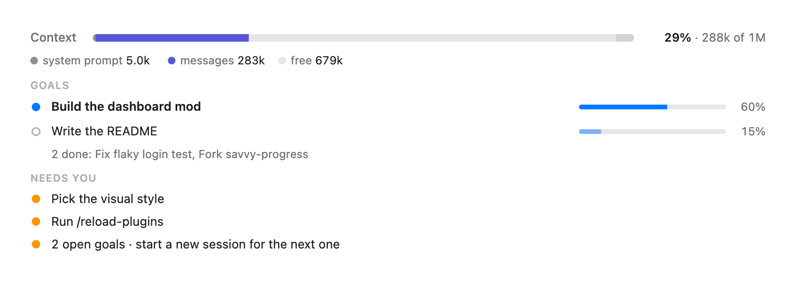
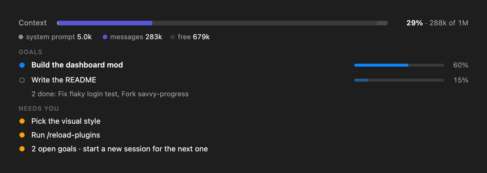
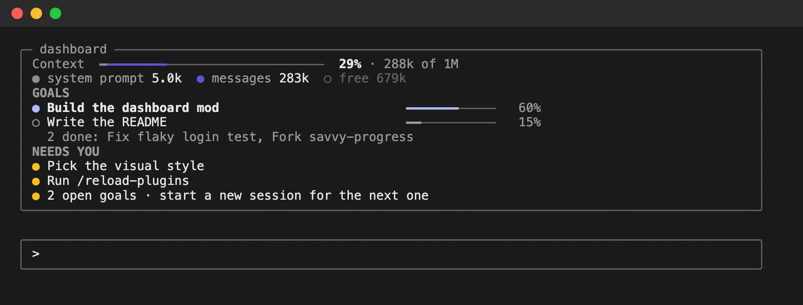

# dashboard

A Claude Code mod: a macOS-style dashboard above the prompt that tells you where the session stands at a glance.

| Desktop app | Desktop app (dark) |
| --- | --- |
|  |  |

**Terminal**



*The screenshots are rendered from the mod itself with sample data.*

## What it shows

- **Context**: the context window as a segmented bar by category (system prompt, messages, MCP tools, free space), with the percentage used.
- **Goals**: every objective the session has pursued, with a progress bar each. Open goals are listed (the active one first); finished ones fold into one line that still names them: `2 done: Fix flaky login test, Fork savvy-progress`.
- **Agents**: the main loop and each running subagent, with its latest action or its reported steps. With the clawd-desk mod's sprites cached at `~/.claude/clawd-desk/sprites.cache.js`, each state gets a Clawd pose; without them the rows draw plainly.
- **Needs you**: what is waiting on you (a question, a decision, a command to run), hidden while Claude works. When a second goal opens, it suggests starting a new session.

Goals and "needs you" come from a small model call after each turn that reads the latest exchanges and updates a short note. That call uses tokens from your plan or API key.

## Commands

`/dashboard` opens the full panel. With an argument:

| Command | Does |
| --- | --- |
| `/dashboard text` | Prints the goals as text in the transcript |
| `/dashboard compact` | Shrinks the band to one line |
| `/dashboard full` | Back to the full band |
| `/dashboard hide` / `show` | Hides or shows the band |

## Install

In a Claude Code terminal session, type:

```
/plugin install dashboard --marketplace salaesp/claude-dashboard-mod
```

Answer `y` to add the marketplace, then pick a scope (`user` to have it in every project).

## Develop

```bash
claude plugin validate .
claude plugin test .
claude --plugin-dir .
```
